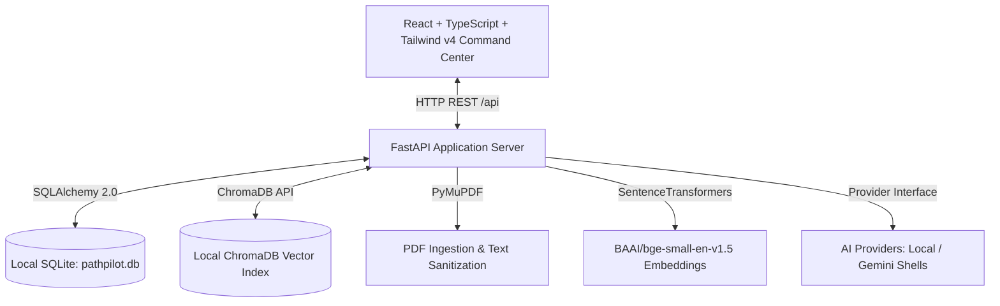

# PathPilot — Personal AI Career Operations Agent

PathPilot is a local-first, privacy-focused career operations assistant that converts career goals into actionable preparation workflows. It helps candidates analyze job descriptions, verify resume evidence against requirements, identify skill gaps, and track concrete roadmap tasks without sending sensitive personal data to external cloud services without consent.

---

## Architecture & Project Reality

Unlike traditional cloud tools, PathPilot is designed to run entirely on the user's local workstation with transparent, explainable heuristics and local vector search.



### Feature Implementation Status

To maintain transparent engineering practices, features are classified by their actual implementation state:

#### ✅ Implemented & Tested
* **FastAPI Backend Core**: Clean REST endpoints with CORS middleware, lifespan database seeding, and health checks (`GET /api/health`).
* **Local Relational Storage**: SQLAlchemy 2.0 declarative models (`User`, `Profile`, `Goal`, `Task`, `Resume`, `CareerState`) persisting locally in SQLite (`pathpilot.db`).
* **PDF Resume Extraction**: PyMuPDF extraction with whitespace normalization, ligature correction, and control character filtering (`backend/app/services/pdf_parser.py`).
* **Conservative Section Detection**: Heuristic section parser identifying Summary, Skills, Experience, Projects, Education, and Certifications (`backend/app/services/section_detector.py`).
* **Local Semantic Vector Store**: Structural chunking and ChromaDB vector indexing using local SentenceTransformers (`BAAI/bge-small-en-v1.5`) with cosine similarity retrieval.
* **Deterministic JD Parser**: Extracts role title, company, required skills, preferred skills, responsibilities, qualifications, experience, and education from plain text or PDF job postings.
* **Evidence-Backed Matching Engine**: Skill alias normalization, keyword presence checks, vector similarity scoring, transparent category weights, and clear strengths/gaps breakdowns (`POST /api/matching/match`).
* **Career Agent Orchestrator**: State-machine workflow (`CareerState`) managing the end-to-end loop: Context Check → Job Discovery → Compatibility Matching → Ranking → Human Review → Task Persistence.
* **Human-in-the-Loop Review**: Shortlisted jobs are presented for user selection; only approved positions generate actionable `Task` items in the database checklist.
* **React Command Center**: React 19 + TypeScript 5 + Vite 8 + Tailwind CSS v4 UI with live backend connectivity indicator, Dashboard, Resume Manager, Job Description Analyzer, and Career Agent interface.
* **Test Isolation**: 32 automated tests running against an isolated in-memory SQLite database (`StaticPool`) and temporary vector stores with zero pollution of development data.

#### 🟡 Partially Integrated & Mocked
* **AI Provider Abstraction**: `AIProvider` base class with `LocalProvider` (Ollama placeholder) and `GeminiProvider` (Google Gemini placeholder) returning simulated responses.
* **Agent Job Search**: The agent's `search_jobs` step queries deterministic local job templates (`MOCK_JOBS_TEMPLATES` for AI/ML and Software) rather than live web scrapers.
* **Preparation Plan Generation**: Approved jobs create targeted application tasks; a dedicated gap-to-curriculum preparation generator is scheduled for Day 12.
* **Single Local User**: Operates in single-user mode resolved dynamically via `settings.DEFAULT_USER_EMAIL` (`pilot@pathpilot.ai`) without cloud authentication.

#### 🔜 Upcoming Work (30-Day Plan)
* **Day 4–7**: Hardened upload contracts, file size limits, MIME validation, and synthetic layout benchmarks.
* **Day 12**: Dedicated deterministic preparation plan generator tied to skill gaps.
* **Day 14–15**: Optional real LLM integration with JSON schema enforcement and evidence grounding.
* **Day 19**: Repeatable evaluation benchmark dataset with precision/recall metrics.
* **Day 22**: Granular application tracking (stages, interview notes, status transitions).
* **Day 25**: Verified reproducible Docker environment.

---

## Tech Stack

| Layer | Technologies |
|---|---|
| **Backend** | Python 3.10+ (tested on 3.14), FastAPI, SQLAlchemy 2.0, SQLite, Pydantic V2, Pydantic Settings |
| **Parsing & Vectors** | PyMuPDF (fitz), ChromaDB, Sentence-Transformers (`BAAI/bge-small-en-v1.5`) |
| **Frontend** | React 19, TypeScript 5, Vite 8, Tailwind CSS v4, Lucide React |
| **Testing** | Pytest, HTTPX, FastAPI TestClient, Oxlint |

---

## Local Setup

### Prerequisites
- **Python 3.10+** (tested on 3.14.6)
- **Node.js v18+** (tested on v20+)
- **npm v9+**

### 1. Environment Configuration

Copy the example environment file:
```powershell
cp .env.example .env
```

The application defaults to safe local-first values. External AI credentials are completely optional:
```ini
# Server configuration
PORT=8000
HOST=127.0.0.1
DATABASE_URL=sqlite:///./pathpilot.db
CORS_ORIGINS=["http://localhost:5173", "http://127.0.0.1:5173", "http://localhost:3000"]
AI_PROVIDER=local
# GEMINI_API_KEY=optional_key_here
```

### 2. Backend Startup

From the **project root directory**:

1. Create and activate a Python virtual environment:
   ```powershell
   python -m venv backend\.venv
   backend\.venv\Scripts\activate   # Windows PowerShell
   # On macOS/Linux: source backend/.venv/bin/activate
   ```

2. Install backend dependencies:
   ```powershell
   pip install -r backend\requirements.txt
   ```

3. Launch the FastAPI server:
   ```powershell
   python -m uvicorn backend.app.main:app --reload --port 8000
   ```
   The backend will start at **`http://localhost:8000`**. On startup, database tables are initialized and default profile records (`Alex Pilot`) are seeded if absent. API docs are available at **`http://localhost:8000/docs`**.

### 3. Frontend Startup

From a second terminal in the **`frontend/`** directory:

1. Install npm packages:
   ```powershell
   cd frontend
   npm install
   ```

2. Start the Vite dev server:
   ```powershell
   npm run dev
   ```
   Open **`http://localhost:5173`** in your browser. The header badge will indicate `Backend: Online`.

---

## Running Verification & Tests

### Backend Tests
Execute pytest from the **project root directory**:
```powershell
backend\.venv\Scripts\python -m pytest backend/tests/ -v
```
All 32 tests run against an in-memory SQLite database (`StaticPool`) and isolated ChromaDB directory, leaving your local development database completely untouched.

### Frontend Lint & Build Checks
Execute oxlint and vite build from the **`frontend/`** directory:
```powershell
cd frontend
npm run lint    # Runs oxlint (0 errors, 0 warnings)
npm run build   # Type-checks and builds production bundle
```

---

## Security, Privacy & Responsible Use

* **Local-First Privacy**: Resume text and job descriptions are processed on your local machine. No private resume text is logged or sent to cloud servers without user configuration.
* **Deterministic Evidence**: Match scores and gap reports are grounded in explicit keyword presence and local semantic similarity. PathPilot does not invent qualifications or infer protected personal attributes.
* **Bounded Scope**: PathPilot is an interactive preparation assistant. It does **not** automatically apply to job boards, send cold emails, or contact recruiters.
* **Disclaimer**: PathPilot match scores and analysis are advisory preparation heuristics and do not guarantee interview or employment outcomes.
