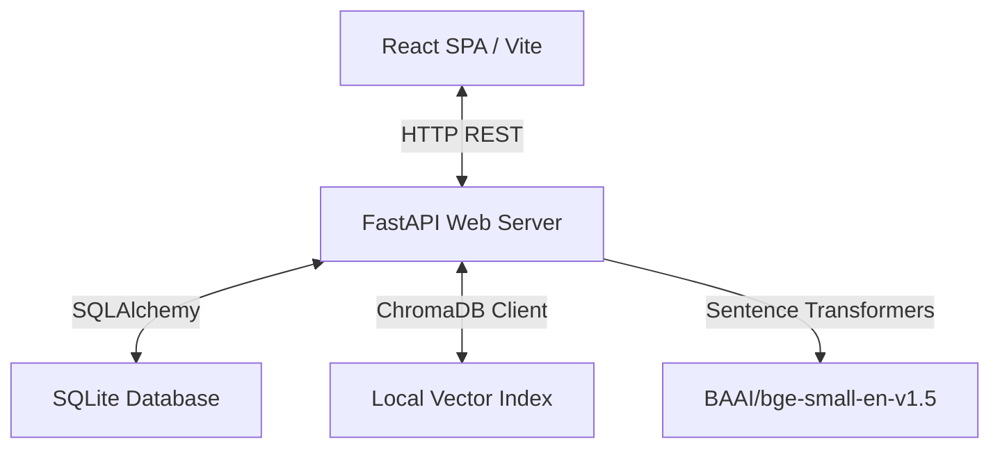
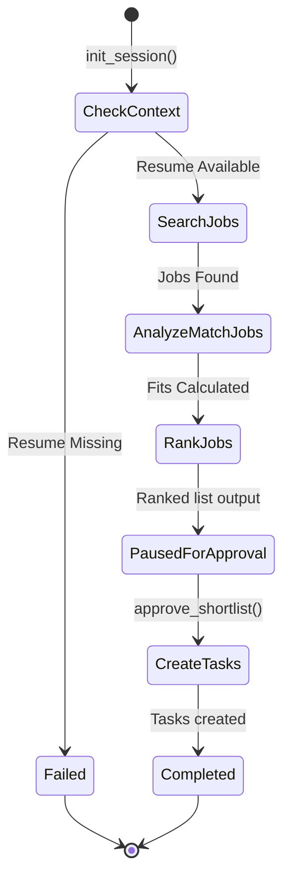

# PathPilot Engineering Handbook

Welcome to the **PathPilot** project repository! This handbook documents the architecture, database models, modular components, and testing conventions adopted for the platform.

PathPilot is designed around a **local-first, privacy-respecting, modular architecture** that runs entirely on the developer's workstation with zero external cloud dependencies.

---

## 1. Technology Stack

PathPilot is split into a decoupled client-server architecture:



### Frontend Client
* **React 18 + Vite**: Fast hot-module-reloading SPA builder.
* **TypeScript**: Strict types with `verbatimModuleSyntax` enabled.
* **Tailwind CSS v4**: Utility-first CSS compiler integrated directly into the Vite pipeline.
* **Lucide React**: Modern iconography toolkit.

### Backend Server
* **Python 3.10+ & FastAPI**: High-performance asynchronous API framework.
* **SQLAlchemy 2.0 & SQLite**: Lightweight relational database.
* **ChromaDB**: Native local vector database for semantic chunk retrieval.
* **Sentence-Transformers**: Runs embedding calculations offline on the CPU.
* **PyMuPDF (fitz)**: Optimized native engine for PDF text extraction.

---

## 2. Active Local User Resolution

To provide a seamless single-user "local experience" without the complexity of Auth0/JWT logins in Phase 1, PathPilot resolves a **default local profile**:

1. **Email Key**: Set inside `backend/app/core/config.py` as `settings.DEFAULT_USER_EMAIL` (defaulting to `"pilot@pathpilot.ai"`).
2. **Resolution Service**: The helper `get_local_user(db)` queries the database for this email. If not found (e.g. fresh database setup), it dynamically creates the default `User` and empty `Profile` records.
3. **Database Links**: Every `Goal`, `Task`, and `Resume` record references the primary key `user_id` resolved from this active profile.

---

## 3. Database Schema Mapping

The relational SQLite database structure (`pathpilot.db`) is declared using SQLAlchemy:

```mermaid
erDiagram
    USERS ||--|| PROFILES : has
    USERS ||--o{ GOALS : tracks
    USERS ||--o{ TASKS : assigns
    USERS ||--|| RESUMES : stores

    USERS {
        int id PK
        string email UK
        string name
        datetime created_at
    }
    PROFILES {
        int id PK
        int user_id FK
        string headline
        string location
        string target_role
        string target_domain
    }
    GOALS {
        int id PK
        int user_id FK
        string title
        string description
        string status
        datetime deadline
    }
    TASKS {
        int id PK
        int user_id FK
        int goal_id FK
        string title
        string description
        string status
        string priority
        datetime due_date
    }
    RESUMES {
        int id PK
        int user_id FK
        string filename
        string raw_text
        json sections
        datetime created_at
    }
```



* **Cascade Rules**: Deleting a `User` cascade-deletes all associated profiles, goals, tasks, and resumes. Deleting a `Goal` nullifies its references inside `Tasks` rather than cascading, allowing task conservation.

---

## 4. Resume Intelligence Pipeline

The resume ingestion and indexing pipeline follows a strict, unidirectional data flow:

```
PDF File -> PDF Parser -> Section Detector -> Chunker -> Embedding Service -> Vector Store
```

### 1. PDF Parser (`pdf_parser.py`)
Uses **PyMuPDF** to read binary bytes from uploaded files.
* Sanitizes character encodings, mapping common ligatures (e.g. `fi` -> `fi`, `fl` -> `fl`).
* Normalizes carriage returns (`\r\n` -> `\n`) and collapses redundant empty lines to clean the raw layout text.

### 2. Section Detector (`section_detector.py`)
Uses regular expressions to scan text lines for prominent resume headers.
* Matches standard categories: `Summary`, `Skills`, `Experience`, `Projects`, `Education`, `Certifications`.
* Enforces strict regex match conditions (word counts, leading space boundaries) to prevent false-positives on mid-paragraph sentences.
* Returns a dictionary mapping detected category labels to their text blocks.

### 3. Chunker (`resume_chunker.py`)
Divides text into semantically cohesive passages.
* **Skills Sections**: Split line-by-line, creating isolated chunks for individual skills.
* **Text Sections**: Split by double newlines (`\n\n`) to preserve paragraph integrity.
* **Semantic Context Prepending**: Prepend the section name to the content (e.g. `Section: Experience\n\n...`) to retain semantic context.

### 5. Vector Store Client (`vector_store.py`)
Manages the local vector index inside `chroma_db/`.
* Configures HNSW index parameters with cosine similarity: `"hnsw:space": "cosine"`.
* **Idempotent Upsert Rule**: Before committing new chunks, it deletes all existing records matching the user's email (`where={"user_email": user_email}`), preventing chunk duplicate pollution.

---

## 5. Backend Testing Conventions

We enforce strict isolation guidelines inside our `pytest` suite:

### 1. Database Thread Sharing
FastAPI injects database sessions concurrently. SQLite in-memory links (`:memory:`) isolate states per connection. To run transactional tests on a shared connection, `tests/conftest.py` configures:
```python
engine = create_engine(..., poolclass=StaticPool, connect_args={"check_same_thread": False})
```

### 2. Isolated Vector DB Directory
ChromaDB locks file handles on Windows. The vector store test fixture sets up a temporary directory that is automatically released upon completion:
```python
@pytest.fixture
def test_vs():
    tmp_dir = tempfile.mkdtemp()
    vs = VectorStore(persist_directory=tmp_dir)
    yield vs
    # Release handles and force garbage collection to unlock files on Windows
    vs.client = None
    import gc
    gc.collect()
    shutil.rmtree(tmp_dir, ignore_errors=True)
```

### 3. Namespace Monkeypatching
When mocking methods inside route integration tests, monkeypatch them directly in the target route controller namespace rather than the source service module, due to Python's import binding behaviour:
```python
import backend.app.api.endpoints.resume as resume_endpoint
monkeypatch.setattr(resume_endpoint, "vector_store", test_vs)
monkeypatch.setattr(resume_endpoint, "extract_text_from_pdf_bytes", mock_parser)
```

---

## 6. Job Description Intelligence Pipeline (Phase 2.2)

Phase 2.2 adds rule-based parsing and requirement extraction for incoming Job Descriptions (JDs), running entirely locally without external LLM dependencies.

### Ingestion Flow
```
JD Input (Text/PDF) -> PDF Text Extractor -> Text Cleaner -> Section Detector & Classifier -> Pydantic Structured Output
```

### Structured Representation
The parsed output matches the `JobDescriptionStructured` Pydantic model:
- `job_title`: Extracted title.
- `company`: Extracted hiring company.
- `required_skills`: List of required technical tools or capabilities.
- `preferred_skills`: List of nice-to-have or preferred skills.
- `responsibilities`: Primary roles, tasks, and duties.
- `qualifications`: Prerequisites or eligibility bullet points.
- `experience`: Sentences detailing years of experience.
- `education`: Lines detailing degrees or educational qualifications.
- `other_requirements`: General uncategorized bullets.

### Extraction Heuristics
1. **Title Detection**: Analyzes the first 3 lines of the text. Matches against a whitelist of job keywords (`engineer`, `developer`, `scientist`, `architect`, etc.). Falls back to the first line.
2. **Company Detection**: Uses regex patterns scanning the first 5 lines (e.g. `at [Company],`, `join [Company]`, `company: [Company]`). Falls back to the second line of the text.
3. **Section Headings**: Matches short lines against pre-defined regex categories:
   - **Responsibilities**: `responsibilities`, `what you'll do`, `key responsibilities`, etc.
   - **Required Skills/Requirements**: `requirements`, `qualifications`, `what you need`, etc.
   - **Preferred Skills**: `preferred qualifications`, `nice to have`, `pluses`, etc.
   - **Education/Experience**: Dedicated sections like `education` and `experience`.
4. **Requirements Classification**: Items under active sections are parsed. Bullet lines inside `Requirements` are scanned for:
   - **Experience Keywords**: Matched via `\d+\+?\s*(years|yrs)` to extract experience criteria.
   - **Education Keywords**: Matched via degrees (`BS`, `MS`, `PhD`, `Bachelor`, `Master`) to extract education criteria.

### Design Decisions & Architectural Choices
- **Stateless Endpoint Design**: The `/api/jd/analyze` endpoints do not write to the SQLite database. They act as fast, deterministic utility endpoints that structure input text/PDFs, transferring storage concern to client-side react state.
- **Dry/Reusable Extraction Utility**: Reuses `extract_text_from_pdf_bytes` and `clean_extracted_text` from the core PDF parser, guaranteeing consistent text formatting across both resume and JD pipelines.

### Heuristic Limitations
- **Format Deviations**: Large paragraphs lacking standard headers (e.g. `Requirements:`, `What you'll do:`) may lead to sub-optimal classification of requirements.
- **Ambiguous Phrasing**: General experience sentences without numbers (e.g. "Previous experience in software development") may be categorized as skills/qualifications rather than strict experience items.

### Technical Interview FAQ
* **Q: Why was an LLM omitted in this phase?**
  * **A**: A rule-based regex and keyword-driven architecture is 100% free, runs instantaneously (sub-10ms compared to LLM latencies), and operates fully offline on the client's machine without API keys. This guarantees high throughput for initial bulk screening of files.
* **Q: How will the system transition to LLMs in future phases?**
  * **A**: The pipeline's modular interface ensures that the text extraction and cleaning layers remain untouched. In Phase 3, the rule-based `jd_parser.py` can be swapped for or combined with an LLM provider (like Gemini or Ollama) using structured JSON output prompts, while maintaining the same Pydantic schema validation contract.

---

## 7. Resume ↔ Job Description Matching Engine (Phase 2.3)

Phase 2.3 implements a local-first, evidence-based Resume ↔ Job Description matching engine. It extracts parsed job criteria and compares them against the active user's indexed resume chunks using semantic vectors and exact keyword matches.

### Architectural Ingestion & Matching Pipeline
```
                    +-----------------------------+
                    |  Job Description Structured |
                    +--------------+--------------+
                                   |
                                   v
             [Categorize Sections: Skills, Experience, Education]
                                   |
                                   v
             [Normalize Tech Skill Names & Resolve Aliases]
                                   |
              +--------------------+--------------------+
              |                                         |
              v (For Skills)                            v (For Text Sentences)
     Keyword Match Check                        ChromaDB Semantic Query
    (Exact/Alias word boundary)                (Cosine similarity match)
              |                                         |
              +--------------------+--------------------+
                                   |
                                   v
              [Classify Match State per Requirement]
        - Strong Match (Sim >= 0.80, or keyword match with Sim >= 0.70)
        - Partial Match (Sim >= 0.70, or keyword match with Sim >= 0.60)
        - Related/Weak Evidence (Sim >= 0.60)
        - Missing (Sim < 0.60) -> Search for Related Skills Fallback
                                   |
                                   v
              [Compute Configurable Weighted Score]
          - Required Skills: 60% default weight
          - Preferred Skills: 20% default weight
          - Experience/Responsibilities: 15% default weight
          - Education/Qualifications: 5% default weight
                                   |
                                   v
                  [Structured Match Report Export]
```

### 1. Skill Normalization & Resolving Aliases
Standardizes variations in technology names using a predefined alias dictionary (`SKILL_ALIASES`).
* Maps synonyms (e.g. `k8s` -> `kubernetes`, `react.js`/`reactjs` -> `react`, `js` -> `javascript`).
* Simplifies strings to lowercase, strips trailing/leading punctuation, and resolves variations to canonical forms.

### 2. Semantic Querying & Cosine Similarity
For each requirement, the engine retrieves the top 3 nearest chunks from the active user's indexed resume in ChromaDB using BGE embedding similarity (`1.0 - distance`).
* Similarity scores are treated as raw matching evidence, not direct hiring probabilities.
* Semantic similarity helps classify the match state and retrieve matching textual snippets from the resume.

### 3. Evidence-Based Match Classification
Each requirement is evaluated and assigned one of four statuses:
* **Strong Match**: Perfect alignment. Set when similarity is high (>= 0.80 for text, or >= 0.82 for skills) OR when there is a direct keyword match in the resume and similarity is >= 0.70.
* **Partial Match**: Substantial but partial match. Set when similarity is moderate (>= 0.70 for text, or >= 0.72 for skills) OR when a keyword matches and similarity is >= 0.60.
* **Related/Weak Evidence**: Very weak semantic alignment (similarity >= 0.60).
* **Missing**: No relevant evidence found (similarity < 0.60).

### 4. Skill-Gap Detection & Related Evidence
If a skill is classified as `Missing` (e.g. Kubernetes), the engine scans a `RELATED_SKILLS` dictionary for candidate fallbacks (e.g. Docker, AWS).
* If a related skill is found in the resume, the status of the target skill remains `Missing` (preserving strict skill-gap integrity).
* However, the best matching chunk for the related skill is returned under `related_evidence` to demonstrate adjacent capabilities.

### 5. Configurable Weighted Score Math
The overall compatibility score is calculated using four configurable weights (default: Required Skills 60%, Preferred Skills 20%, Experience 15%, Education 5%):
$$\text{Overall Score} = \sum_{c} (\text{Category Score}_c \times \text{Weight}_c)$$
* Each item in a category is scored: Strong Match = 1.0, Partial = 0.5, Related/Weak = 0.25, Missing = 0.0.
* The Category Score is the average item score times 100.
* **Weight Normalization**: If a category has no items listed in the JD (e.g., no preferred skills), its weight is redistributed proportionally to other active categories, ensuring the score remains accurate and fair.

### 6. Heuristic & Semantic Limitations
* **Scale Invariance**: Cosine similarity scales values between 0.0 and 1.0, but BGE model characteristics mean similarities rarely drop below 0.3. Thus, a similarity threshold of 0.60 is used for detecting basic relevance.
* **Granularity**: The pipeline does not evaluate duration of skill usage or check if experience was recent.

### 7. Technical Interview FAQ
* **Q: Why not map a similarity score of 0.91 directly to a 91% job match?**
  * **A**: Semantic similarity only measures textual and semantic proximity in vector space, not professional competency, depth of experience, or actual hiring probability. Equating the two would mislead users. Instead, we use similarity as evidence to drive a rule-based matching classifier.
* **Q: Why does a missing skill remain missing if related evidence exists?**
  * **A**: Recruiters often look for specific target tools. Over-claiming a match when you only know a related tool can lead to automated rejections or interview failure. Classifying it as "Missing" while presenting "Related Evidence" offers transparency to both the applicant and system.
* **Q: How does weight normalization handle incomplete job descriptions?**
  * **A**: JDs are often poorly formatted and may lack preferred skills or qualifications. Standard weighted averages would penalize the user if these sections are empty. By dynamically normalizing weights to active categories, the engine evaluates fit purely on the information present.

---

## 8. Phase 3: Career Agent Orchestrator and Decision Loop (Phase 3)

Phase 3 introduces an agentic workflow for career planning, transitioning from static, sequential parsing/matching pipelines to a dynamic, stateful agent decision loop that supports human-in-the-loop approval, pause/resume workflows, and robust failure handling.

### 1. Agent vs Pipeline
* **Static Pipeline**: The resume and JD parsing and matching engines developed in Phase 2 are static pipelines. They perform a single pass of data ingestion and rule-based processing. They are deterministic, stateless, and run sequentially from start to finish without self-correction, state transitions, or feedback.
* **Agentic Workflow**: The Career Orchestrator is an agent. It maintains a persistent state (`CareerState`), runs a multi-step decision loop, decides which tool to run next based on context, handles failures gracefully, and pauses for human verification before finalizing its outputs (creating tasks in the database).

### 2. Career Orchestrator
The `AgentService` ([`agent_service.py`](file:///c:/Users/Meet/Desktop/pathpilot/backend/app/services/agent_service.py)) acts as the Career Orchestrator. It:
1. Initializes or resets a session with a target career goal.
2. Heuristically parses the goal to extract target role and location.
3. Steps through a series of discrete tools based on the active state.
4. Pauses for human review once a ranked list of compatible jobs is generated.
5. Resumes execution upon receiving user-selected approvals, translating them into actionable tasks.

### 3. Agent Database State (`CareerState`)
The agent's state is persisted in SQLite using the `CareerState` model ([`career_state.py`](file:///c:/Users/Meet/Desktop/pathpilot/backend/app/models/career_state.py)). The table `career_states` tracks:
* `id` & `user_id`: Primary key and foreign key to the active user profile (one active session per user).
* `goal`: The user's input career goal string.
* `target_role` & `location`: Extracted criteria from the goal.
* `resume_available` & `resume_filename`: Boolean flag and name of the active resume.
* `status`: Current state of the session (`idle`, `running`, `paused_for_approval`, `completed`, `failed`).
* `next_action`: The next tool to execute in the loop (`Check Context`, `Search Jobs`, `Analyze & Match Jobs`, `Rank Jobs`, `Await User Approval`, `Create Tasks`, `Finished`).
* `logs`: A JSON-serialized array recording every tool invocation and observation.
* `jobs_found`: Intermediary storage for retrieved mock job listings.
* `matches`: Compatibility reports computed by the matching engine.
* `shortlisted_jobs`: Job listings sorted descending by compatibility score.
* `pending_approval`: Boolean flag indicating that the orchestrator is awaiting user input.

### 4. State Memory & Agent Context
* **Temporary State**: In-memory data structures during a single step run (e.g., individual parsed job description dicts before they are serialized and saved to the `matches` column).
* **Persistent Memory**: The serialized columns in `CareerState` (e.g., `jobs_found`, `matches`, `shortlisted_jobs`, `logs`). This allows the agent to maintain context across server restarts and client page refreshes.
* **Agent Context**: The user's profile, active resume chunks indexed in ChromaDB, and active session details. Together, these guide the orchestrator's behavior.

### 5. Tools vs Agents
* **Tools**: Discrete, single-purpose functions. Examples include:
  * `search_jobs`: Generates or queries job listings based on role/location.
  * `match_resume_to_jd`: Runs ChromaDB queries and calculates the weighted match score.
  * `create_task`: Appends new tasks to the user's roadmap database table.
* **Agents**: The decision maker that reads the active state, evaluates conditions (e.g., is the resume uploaded?), chooses the appropriate tool, runs it, logs the output, and updates the `next_action` and `status` to progress through the lifecycle.

### 6. The Agent Decision Loop
The decision loop is driven by `run_orchestration_step(db, session_id)` and progresses through these states:


1. **Check Context**: Resolves the user's active resume. If missing, transitions to `failed` with next action set to `Upload Resume`. If present, sets next action to `Search Jobs`.
2. **Search Jobs**: Executes the `search_jobs` tool, retrieving jobs matching `target_role` and `location`. Stores them in `jobs_found` and transitions to `Analyze & Match Jobs`.
3. **Analyze & Match Jobs**: Runs `match_resume_to_jd` for each retrieved job, comparing it against the active resume's semantic vector database. Saves matching reports to `matches` and transitions to `Rank Jobs`.
4. **Rank Jobs**: Sorts matched jobs by score descending and saves to `shortlisted_jobs`. Sets `status = paused_for_approval`, `pending_approval = True`, and `next_action = Await User Approval`.
5. **Await User Approval**: Pauses execution. Awaiting user input.
6. **Create Tasks**: Resumes upon receiving approved index list. Creates database `Task` records for approved jobs, linking them to the active `Goal`. Sets `status = completed` and `next_action = Finished`.

### 7. Human-in-the-Loop & Pause/Resume
* **Pause Hook**: The loop halts during `Rank Jobs`. The orchestrator writes the sorted results to the database and switches `status` to `paused_for_approval`.
* **Resume Hook**: The UI renders a list of shortlisted jobs with checkboxes. When the user clicks "Approve", it calls `/api/agent/session/approve`, which calls `approve_shortlist(db, session_id, approved_indexes)`. This updates `pending_approval = False`, transitions `status` back to `running`, and immediately fires the task creation step.

### 8. Failure Handling
* If a critical prerequisite is missing (such as the resume not being uploaded), the agent transitions to a `failed` status, records the reason in the logs, and sets the next action to instruct the user on how to resolve the block (e.g., `Upload Resume`).
* The frontend reads the `failed` status and `logs` to display appropriate error screens and call-to-action buttons.

### 9. Architectural Decisions & Rationale
* **SQLite Relational Memory**: Local JSON/MutableList columns inside SQLite store intermediary agent state. This avoids the overhead of a separate key-value memory store (like Redis) and guarantees ACID compliance with low overhead.
* **Deterministic Transition Loop**: For the local single-user phase, transitions are implemented as state-machine mappings rather than LLM reasoning prompts. This ensures 100% reliable execution loops, eliminates token costs, and runs instantaneously, while establishing the API contracts for future LLM integration.

### 10. Limitations
* **Local Scope**: Single-session per user limits parallel executions.
* **Mock Listings**: Currently queries local simulated templates rather than live web scraping.
* **Synchronous Triggering**: The backend relies on the client sending `/step` API triggers to advance the agent, rather than running a background thread/celery worker daemon.

### 11. Technical Interview FAQ
* **Q: Why was the agent state engine implemented as a state machine rather than an LLM prompt loop?**
  * **A**: Relational state machines run instantaneously, are free, and are 100% deterministic, whereas LLM-based agent reasoning loops are slow, prone to hallucination, expensive, and fragile. Building the architecture around a state machine enforces strict state and boundary safety. In future phases, LLMs can be plugged in to perform reasoning *within* individual states (like extracting complex JD parameters) while the core orchestrator keeps state integrity absolute.
* **Q: How does the agent handle persistence when the application is restarted?**
  * **A**: Since all state (current step, logs, mock jobs, and matching results) is stored in the SQLite `career_states` table, the agent can recover perfectly. When the application loads, the frontend calls the `/session/active` endpoint, retrieves the last saved state, and renders the correct screen (e.g., resuming from the exact step or showing the human-in-the-loop approval panel).

### 12. Frontend Client UI & Integration
The client-side interface is fully integrated as the **Career Agent** tab inside the React command center. It consists of the following systems:
* **Goal Prompt Setup**: Renders when there is no active session (`null` state). Allows users to submit a target objective and provides template shortcuts.
* **Stepper Timeline Visualizer**: A vertical progress tracker tracking the active state transition (`Check Context` -> `Search Jobs` -> `Analyze & Match` -> `Rank Jobs` -> `Await User Approval` -> `Create Tasks` -> `Finished`).
* **Scrolling Log Terminal**: A simulated black-box shell window feeding the `logs` string array returned from the backend, auto-scrolling to the bottom as the agent executes.
* **Auto-Advance Execution Loop**: Utilizes a configurable interval loop triggered when status is `running` and next_action is not blocked. It automatically posts `/session/step` triggers to progress the state machine without manual clicking.
* **Human-in-the-Loop Checklist**: Renders when status is `paused_for_approval`. Lists the shortlisted jobs with their overall semantic compatibility scores (fit percentage), recommendations, key strengths, and gaps to resolve, providing checkboxes for selective approval and task creation.


